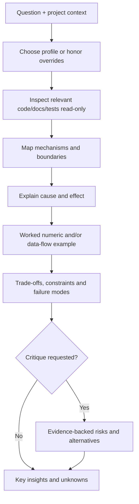

<div align="center">

# Senior Deep Dive

### Understand the architecture. Understand the decisions. Skip the code-tour noise.

**One portable Agent Skill for high-abstraction, high-depth technical explanations.**

[](https://agentskills.io/)
[](https://developers.openai.com/api/docs/guides/tools-skills)
[](https://code.claude.com/docs/en/skills)
[](https://cursor.com/docs/skills)
[](LICENSE)

**Auto-adaptive by default · Override any dimension · Evidence-first · Read-only · Hebrew & English**

[**עברית — מדריך בעברית**](README.he.md)

</div>

---

## The idea

Most AI explanations fall into one of two traps: a shallow 101-level summary, or an exhaustive walkthrough of files and functions. Senior Deep Dive occupies the missing quadrant:

| | Low technical depth | **High technical depth** |
| --- | --- | --- |
| **High abstraction** | Generic overview | **Senior Deep Dive — the goal** |
| Low abstraction | Isolated implementation snippets | Line-by-line code archaeology |

Ask **“Why does our RAG pipeline need a reranker?”** and get mechanisms, data movement, realistic numbers, competing choices, failure modes, and what to measure — **without** being dragged through framework syntax.

> **High-level ≠ shallow.** The Skill goes deep into engineering *reasoning*, not incidental implementation detail.

## What makes it different?

| Capability | Behavior |
| --- | --- |
| **Auto-profiling** | Infers depth, focus, example style, explanation/critique mode and language from the question. |
| **Independent overrides** | Set only `focus=theory`; all other dimensions remain automatic. |
| **Deep / Very deep** | More rigorous causality, assumptions, trade-offs and validation — not more source-code noise. |
| **Evidence-first** | Connects explanations to actual source, tests and config; separates verified facts, intent, inference and unknowns. |
| **Numeric + data-flow examples** | Traces input → transformations → outputs with units, intermediate values, and clearly labeled hypothetical numbers. |
| **Explain / Critique** | Understand the current design first; critique alternatives and risks only when requested. |
| **Read-only** | No silent code edits, builds, unapproved data transfers or side effects just to answer a conceptual question. |
| **Portable** | Standard `SKILL.md` plus optional references. No framework, MCP server or paid dependency required. |

## Quick start

### Install for all your projects

Clone this repository after publishing it:

```bash
git clone https://github.com/GuyvDev/senior-deep-dive-skill.git
cd senior-deep-dive-skill
mkdir -p ~/.agents/skills
cp -R skills/senior-deep-dive ~/.agents/skills/
```

The standard `~/.agents/skills/` location is supported by **Codex**, **Cursor**, and **GitHub Copilot** on their supported environments. For **Claude Code**, copy the same folder to `~/.claude/skills/`:

```bash
mkdir -p ~/.claude/skills
cp -R skills/senior-deep-dive ~/.claude/skills/
```

For a **single repository**, copy the skill folder into `.agents/skills/senior-deep-dive/` (or `.claude/skills/senior-deep-dive/` for Claude Code). The SKILL.md frontmatter enables automatic discovery in clients that support Agent Skills. You can also invoke it explicitly in compatible tools with `senior-deep-dive` / `/senior-deep-dive` / `$senior-deep-dive` according to the client's invocation syntax.

> Platform support and discovery behavior can change. See [Codex Skills](https://developers.openai.com/api/docs/guides/tools-skills), [Claude Code Skills](https://code.claude.com/docs/en/skills), [Cursor Skills](https://cursor.com/docs/skills), and [Copilot Skills](https://docs.github.com/en/copilot/how-tos/copilot-on-github/customize-copilot/customize-cloud-agent/add-skills).

### Ask naturally

```text
Explain how authorization works end to end in this repository.

Why did we use a queue instead of direct RPC? Include realistic numbers.

תסביר לי איך ה-GPU pipeline עובד בפרויקט, ברמת Senior עם דוגמאות.

תבקר את הארכיטקטורה ותסביר באילו תנאים היית בוחר חלופה אחרת.
```

You do **not** need to select settings. The agent picks them automatically unless you override them.

## Controls

Five independent dimensions. Set one, several, or none:

| Setting | Values | Automatic behavior |
| --- | --- | --- |
| `depth` | `auto` · `deep` · `very-deep` | Deep for focused topics; very-deep for interacting mechanisms, rigorous theory or critical design analysis. |
| `focus` | `auto` · `balanced` · `mechanisms` · `tradeoffs` · `theory` · `all` | Match intent: flow, alternatives, math or broad understanding. |
| `examples` | `auto` · `numeric` · `flow` · `both` | Prefer numbers and flow together when useful; never invent project results. |
| `mode` | `auto` · `explain` · `critique` | Explain by default; critique when asked. |
| `language` | `auto` · `he` · `en` | Follow the user; Hebrew explanations retain standard English technical terms. |

> **`all` is not a command to become verbose.** It means covering all *relevant* engineering angles without repetition.

### Example overrides

```text
depth=very-deep focus=theory examples=both
Explain the mathematical mechanism of attention and what it implies for memory and throughput.
```

```text
עומק=עמוק מאוד, דגש=מנגנונים, דוגמאות=מספרים וזרימה
תסביר איך תמונה עוברת דרך שלבי ה-CUDA pipeline שלנו.
```

```text
focus=tradeoffs mode=critique
Do we really need a second retrieval stage, or should we increase top-k?
```

```text
examples=flow
Walk through what happens when a worker crashes while holding a job.
```

Only the supplied dimensions become fixed. Language, depth, mode and the rest remain automatic.

## How it works



**The answer adapts to the question**, not a rigid outline. A narrow question gets a focused deep explanation; a high-stakes architecture question can invoke invariants, measurable alternatives, counterexamples and error recovery.

### A tiny example

**Question:** “Why have a reranker after vector search?”

**Mechanism:** a fast retriever finds a broad candidate pool; a more expensive model scores query/document pairs more precisely. Reranking improves **ordering**, but cannot rescue evidence that the retriever never found.

**Illustrative flow:**

```text
Question → vector retrieval (top 50)
         → 50 query–chunk pairs
         → reranker (top 5)
         → prompt assembly → LLM answer
```

**Illustrative math (not project benchmarks):** suppose retrieval takes 25 ms, reranking takes 80 ms and generation takes 600 ms. Total ~705 ms with reranking vs ~625 ms without, ignoring network and queue time. That's about a **13% end-to-end latency increase** for a quality improvement that needs to be *measured*, not assumed. Evaluate retrieval with Recall@50, ranking with nDCG@5 and end-to-end answer quality with task-relevant metrics.

**Trade-off:** reranking adds latency and compute; increasing the first-stage candidate count may improve recall but also increase reranking cost. A senior-level explanation makes these decision boundaries explicit, then checks the project's actual implementation and numbers when accessible.

The skill also includes an AHE/CUDA worked example with tile histograms, CDFs and bilinear interpolation, including stepwise values — see [`references/examples.md`](skills/senior-deep-dive/references/examples.md).

## Repository structure

```text
senior-deep-dive-skill/
├── README.md
├── LICENSE
├── skills/
│   └── senior-deep-dive/
│       ├── SKILL.md                  # Lean core workflow + router
│       └── references/
│           ├── profiles.md          # Auto-selection, explicit overrides
│           ├── evidence.md          # Grounding, confidence, no hallucinations
│           ├── examples.md          # Worked numeric + flow patterns
│           └── critique.md          # Architecture assessment rubric
├── evals/
│   ├── scenarios.json               # Positive + negative test prompts
│   ├── README.md                    # Behavior evaluation protocol
│   └── QA_REPORT.md                 # Verification summary
├── tests/
│   ├── test_skill.py                # Zero-dependency static validations
│   └── test_links.py                # Link + arithmetic verification
└── .github/workflows/validate.yml  # CI structural checks
```

## Testing

```bash
python3 -m unittest discover -s tests -v
```

The **11 automated checks** validate frontmatter, references and links, selector presence, read-only safeguards, worked-example arithmetic, and the scenario suite. A verification summary is available in [`evals/QA_REPORT.md`](evals/QA_REPORT.md). There are **17 behavior/trigger scenarios**, including explicit overrides, Hebrew, mathematical depth, critique, missing repositories, and negative cases where the skill should *not* trigger.

**Important:** static tests verify the package and test-case coverage, **not** actual LLM behavior. For model-level verification, follow [`evals/README.md`](evals/README.md) to run the prompts on the same repository with and without the skill and score factual grounding, depth, flow, numerical honesty and correct invocation.

## Design influences and acknowledgments

This Skill is an **original combination of ideas and workflows**, not a copy or bundled redistribution of other projects. Valuable precedents:

- [poteto/how](https://github.com/poteto/how) — explain versus critique, senior-level architectural onboarding and focused codebase exploration.
- [doyled-it/explain-codebase-skill](https://github.com/doyled-it/explain-codebase-skill) — structured flow diagrams and source-grounded explanations.
- [cdvel/architecture-skills](https://github.com/cdvel/architecture-skills) — code as source of truth, explicit inference labeling, ADR/glossary/brief conventions.
- [Data-System-School/investigate-codebase](https://github.com/Data-System-School/agent-skills/tree/main/investigate-codebase) — thin vertical slices, falsifiable codebase models, read-only investigation.
- [C4 Model](https://c4model.com/) and [arc42](https://arc42.org/) — framing architecture and engineering decisions.
- [OpenAI Skills guidance](https://developers.openai.com/api/docs/guides/tools-skills), [OpenAI guidance on lean skills](https://developers.openai.com/blog/rethinking-skills-and-prompts-for-gpt-6-astra), [Anthropic best practices](https://platform.claude.com/docs/en/agents-and-tools/agent-skills/best-practices), and the [Agent Skills specification](https://agentskills.io/specification) — packaging, discovery, progressive disclosure and evaluation.

None of these projects is required to use this skill. No borrowed source files are included.

## Publishing a new public repository

This package is prepared for an independent GitHub repository. After signing in with GitHub CLI (`gh auth login`), run from the extracted project root:

```bash
git init -b main
git add .
git commit -m "Initial release: Senior Deep Dive Agent Skill"
gh repo create GuyvDev/senior-deep-dive-skill --public --source=. --remote=origin --push
```

This publishes **only these files** to a **new public repository**. It does not modify any existing personal project. If the repository already exists, use the usual `git remote add origin ...` and `git push -u origin main` workflow instead.

## Limitations

- A skill does **not** grant access to a repository or external system. The agent needs appropriate tools and permissions.
- It cannot infer true design intent, production metrics or safety properties from incomplete evidence.
- Automatic invocation depends on the host agent; explicit invocation is more reliable when you need this exact style.
- Some clients support slash commands or other invocation syntax differently. Use the documented skill directory for each host.
- Safety and read-only instructions guide the agent but do not replace host-level tool permissions.

## License

MIT © 2026 [GuyvDev](https://github.com/GuyvDev). Contributions and feedback are welcome.
